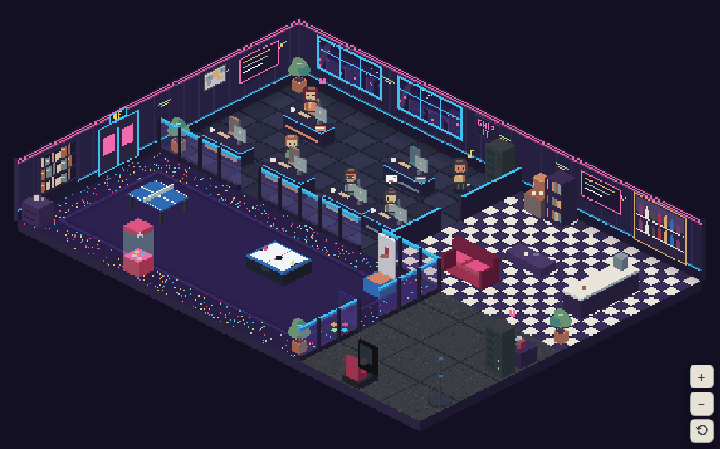
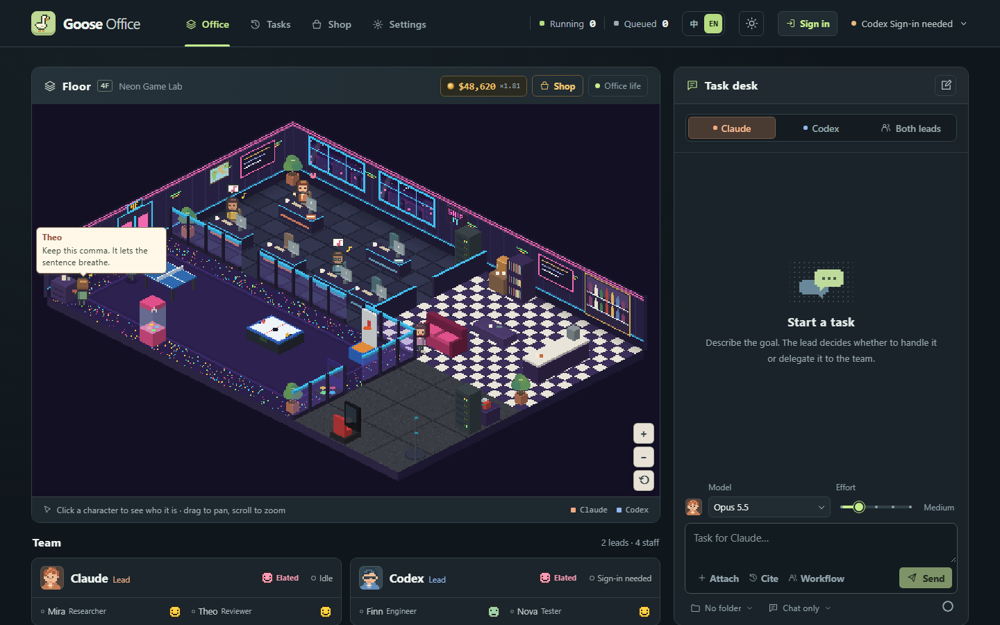
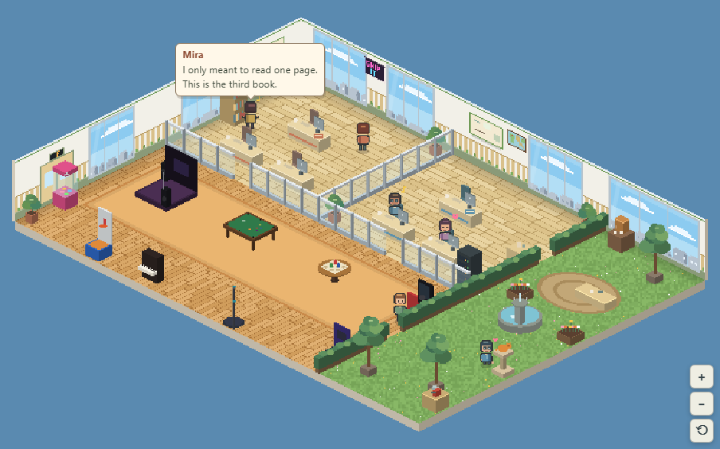
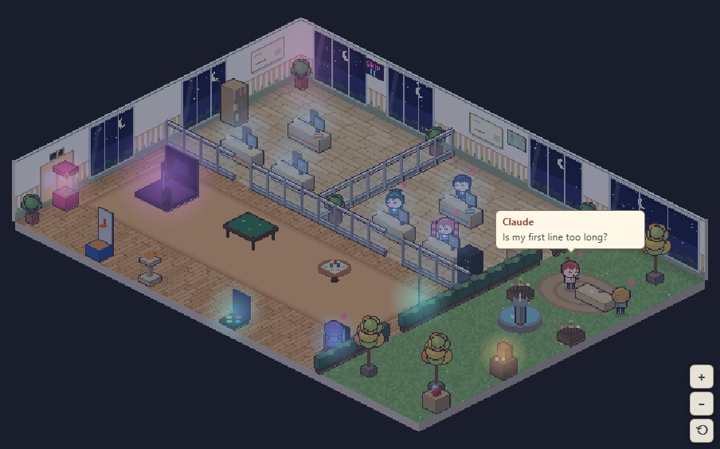
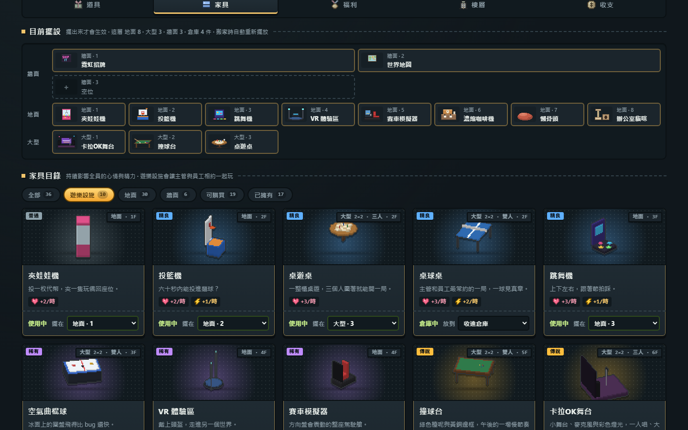
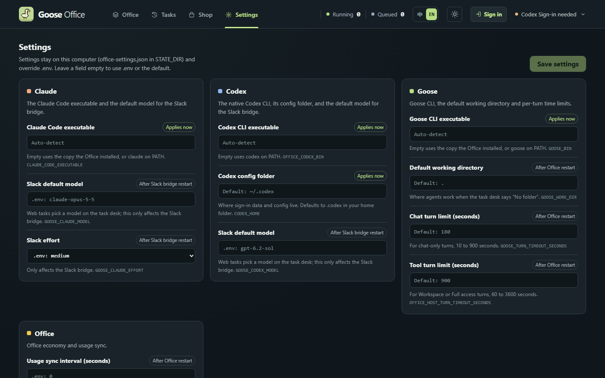

<div align="center">

# Goose Office

**A pixel-art office where Claude and Codex run your AI team.**
Hand tasks to two leads, watch their staff walk, chat and play between jobs, and spend the quota you use on a bigger office.

English · [繁體中文](README.zh-TW.md)

 



</div>

Goose Office is a local web app for working with **Claude Code** and **OpenAI Codex** through [Goose](https://github.com/aaif-goose/goose), using the subscriptions you already have. Two leads, Claude and Codex, each manage two staff members. You give them work from a task desk. They answer, delegate, review each other's results, and live in an isometric pixel office that grows as you use them.

An optional **Slack bridge** puts the same two agents in a private Slack channel, each with its own bot identity.

> [!NOTE]
> Everything runs on your computer. The web app only listens on `127.0.0.1`, keeps its data in `.data/`, and signs in with your own Claude and ChatGPT subscriptions. Every real task uses your subscription quota.

## Contents

- [Features](#features)
- [Quick start](#quick-start)
- [Using the office](#using-the-office)
- [The office game](#the-office-game)
- [Settings](#settings)
- [Slack bridge](#slack-bridge)
- [Development](#development)
- [Credits](#credits)
- [License](#license)

## Features

| | |
| --- | --- |
| **Two leads, four staff** | Claude leads Mira (research) and Theo (review); Codex leads Finn (engineering) and Nova (testing). Leads reply themselves, delegate to staff, or plan a workflow of up to six steps. |
| **Real work, with permissions** | Pick a project folder and a permission mode per task: *Chat only*, *Workspace* (read, write and run commands in the folder) or *Full access*. |
| **Attachments, citations, memory** | Attach images, PDFs and text files, paste screenshots, cite past tasks, and approve memories and skills for each team member. |
| **Anime chibi staff** | Hand-made anime-style pixel sprites: big eyes, layered bangs, and a signature look for each person (Claude's cowlick, Nova's pink twin tails, Finn's goggles…). |
| **Illustrated look, day and night** | Fine ink outlines, a paper backdrop and puffy trees that change with the seasons. In the evening the office dims and monitors, lamps and arcade machines glow; switch between auto, day and night in the floor header. |
| **Pseudo-3D furniture** | Plants and shop furniture are sprite-stacked voxel models that spin on shop cards like a product turntable. |
| **A living office** | Seven isometric floors. Staff fidget at their desks, wander, visit each other, and invite colleagues to ping-pong, air hockey, pool or karaoke. |
| **An office economy** | The quota you use earns funds. Buy snacks and gifts, furniture, arcade games and perks, and move up to bigger floors. |
| **中文 / English** | Switch the whole interface between Traditional Chinese and English from the top bar. |
| **Settings page** | Point the office at your Claude Code, Codex and Goose executables and adjust time limits without editing `.env`. |
| **Subscription usage** | See how much of each subscription window you've used and when it resets. |

## Quick start

**You need:** Node.js 24 or later, a Claude subscription for Claude Code, and a ChatGPT subscription for Codex. Goose CLI and Claude Code can be installed for you on first run.

```powershell
git clone https://github.com/danieltsai0423/goose-slack-agents.git
cd goose-slack-agents
npm ci
npm run office
```

Open **http://127.0.0.1:4178/** and click **Sign in → Start setup** at the top right. Goose Office installs any missing tools into the project's state folder and opens the official Claude and ChatGPT authorization pages in turn. Accounts that are already signed in are skipped, and checking sign-in never sends a model request.

<details>
<summary><b>Manual setup</b> (if automatic install isn't supported on your system)</summary>

- **Goose CLI:** the project is tested with [Goose 1.60.2](https://github.com/aaif-goose/goose/releases/tag/v1.60.2). On Windows, unzip it into `.tools/goose` or add `goose.exe` to `PATH`, or set the path on the **Settings** page.
- **Codex for Goose:** run `npm run configure -- codex`, choose **Configure Providers → ChatGPT Codex**, and sign in with your ChatGPT account in the browser. A native Codex CLI sign-in doesn't carry over to this Goose profile.
- **Claude:** sign in to Claude Code with your own subscription (`claude auth login`). Anthropic decides how third-party tools may use a Claude account. See [Logging in to your Claude account](https://support.claude.com/en/articles/13189465-log-in-to-your-claude-account).
- **Native Codex CLI (optional):** unlocks the `xhigh` and `max` effort levels that Goose doesn't support yet.

  ```powershell
  npm install --prefix .tools/office-codex --save-exact @openai/codex@0.171.0
  node .tools/office-codex/node_modules/@openai/codex/bin/codex.js login
  ```

To check a sign-in with one real model request each:

```powershell
npm run smoke -- codex
npm run smoke -- claude
```

</details>

## Using the office



1. **Pick who gets the task** on the task desk: Claude, Codex, or both leads. Choose a model and reasoning effort; the browser remembers your choice. Defaults are Opus 5.5 · Medium and GPT-6.2 Sol · XHigh (High if the native Codex CLI isn't signed in).
2. **Choose a folder and permission** at the bottom left. *Chat only* uses no tools; *Workspace* works inside the project folder; *Full access* can reach the network and any file on your computer.
3. **Send it.** Leads decide whether to answer directly or delegate. The work log shows each turn, tool use and timing while it runs. Ask follow-ups in the same thread.

More tools on the task desk:

- **Attach:** PNG, JPEG, WebP, PDF, TXT, Markdown, CSV and JSON. Up to 5 files: 7 MB per image, 10 MB per other file, 20 MB in total. You can also paste screenshots.
- **Cite:** Search past tasks and attach up to four snippets as reference material.
- **Workflow:** Up to six steps with owners and dependencies, reviewed by one lead at the end. Independent chat-only steps on different services run in parallel. If a step fails, retry it from the **workflow board**.
- **Memory & skills:** Propose, approve, reject or archive notes for each team member under **Tasks → Memory & skills**. Skills load only when a task matches their triggers.
- **Results:** Agents with tool access can save files under `.data/office-files/` and link them in the chat for download. Images, video and audio preview inline.

Agents' replies support Markdown, including bold text, lists, tables, links and code. Tasks and conversations are stored in `.data/office.sqlite`.

> [!IMPORTANT]
> Claude and Goose runs have no sandbox: *Workspace* limits them only through instructions. The native Codex CLI uses its `workspace-write` and `danger-full-access` sandboxes. Use *Full access* only for tasks you trust.

## The office game



Between tasks, everyone has a life of their own. At their desks they sip tea, scroll their phones, think, stretch, doze when tired, or spin their chairs. They walk to the whiteboard, the window or the lounge, drop by a colleague's desk for a chat, and wave at people passing by. When a task arrives, they head straight back to their desk.



**Funds.** Every 1% of subscription quota used earns $40, multiplied by your floor, furniture, perks and team morale. Work tires the team that did it, and better mood and energy raise morale from ×0.8 up to ×1.25.



The **Shop** has four sections:

- **Items:** Tea, espresso, bubble tea, ramen, sweets, nap pillows and more, given to one person (everyone has a favorite worth ×1.6), or team events like a party or a hot-spring trip.
- **Furniture:** A bonsai, espresso machine, aquarium, office cat, sleep pod and more, plus **ten games**. Single-player games include a claw machine, basketball machine, dance machine, VR and a racing simulator. The 2×2 games are ping-pong, air hockey, pool, karaoke and board games, and staff invite each other to play these together. Games only animate while someone is playing.
- **Perks:** Flexible hours, gym subsidy, pet-friendly office, year-end bonus. Buy once, keep forever.
- **Floors:** The building has seven floors. Bigger floors cost more, earn more and fit more:

| Floor | Size | Small / large / wall spots |
| --- | --- | --- |
| 1F Warm Wood Studio | 14 × 11 | 3 / 0 / 1 |
| 2F Industrial Loft | 16 × 12 | 5 / 1 / 2 |
| 3F Mid-century Modern | 18 × 13 | 6 / 1 / 2 |
| 4F Neon Game Lab | 20 × 14 | 6 / 2 / 2 |
| 5F Forest Atrium | 20 × 14 | 6 / 2 / 2 |
| 6F Skyline Penthouse | 20 × 15 | 7 / 2 / 2 |
| 7F Sky Campus | 24 × 17 | 8 / 3 / 3 |

The starting studio has no room for 2×2 games. Anything that doesn't fit waits in storage and is unpacked automatically when you move up. Funds and moods are kept in `.data/office-economy.json`.

**Controls.** Drag to pan, and scroll or pinch to zoom; the arrow keys, `+`, `−` and `0` work too. The day/night button in the floor header cycles **auto** (night from 7 pm to 6 am on your clock), **day** and **night**; trees and the view outside follow the season. **Office life** in the floor header is the master switch for animation. It starts off if your system asks for reduced motion, and turning it on overrides that.

## Settings



The **Settings** page in the top bar configures the three tools without touching `.env`. Values are saved to `.data/office-settings.json` on your computer and take priority over `.env`. Leave a field empty to fall back to `.env` or the built-in default. Each field says whether it applies immediately or after a restart.

| Setting | Variable | Applies |
| --- | --- | --- |
| Claude Code executable | `CLAUDE_CODE_EXECUTABLE` | Immediately |
| Codex CLI executable | `OFFICE_CODEX_BIN` | Immediately |
| Codex config folder | `CODEX_HOME` | Immediately |
| Goose CLI executable | `GOOSE_BIN` | Immediately |
| Default working directory | `GOOSE_WORK_DIR` | After Office restart |
| Chat turn limit (10–900 s) | `GOOSE_TURN_TIMEOUT_SECONDS` | After Office restart |
| Tool turn limit (60–3600 s) | `OFFICE_HOST_TURN_TIMEOUT_SECONDS` | After Office restart |
| Usage sync interval (0 or 60–86400 s) | `OFFICE_ECONOMY_SYNC_SECONDS` | After Office restart |
| Slack default models and effort | `GOOSE_CLAUDE_MODEL`, `GOOSE_CODEX_MODEL`, `GOOSE_CLAUDE_EFFORT` | After Slack bridge restart |

You can also set any of these in `.env` (see [`.env.example`](.env.example)), along with `OFFICE_PORT` to change the web port and `STATE_DIR` to move the data folder.

## Slack bridge

The bridge lets `Goose-Codex` and `Goose-Claude` reply in a private Slack channel, each as its own bot. A single process receives channel messages and records threads in SQLite. Goose only calls a model when an agent is mentioned or collaboration is turned on. The web office shows the bridge's saved threads read-only under **Tasks → Slack log**.

| Agent | Goose provider | Account |
| --- | --- | --- |
| Goose-Codex | `chatgpt_codex` | ChatGPT sign-in in the bridge's own Goose profile |
| Goose-Claude | `claude-acp` | Your Claude subscription, signed in to Claude Code on the same system account |

<details>
<summary><b>Set up the Slack apps</b></summary>

1. Create a private channel in your workspace, for example `#agent-lab`. Then create the two apps in one of two ways:
   - **With the API:** on the [Slack app page](https://api.slack.com/apps), generate an *App Configuration Token* for the workspace. Put `SLACK_MANIFEST_TOKEN=...` in a local `.env.slack-setup`, then run `npm run slack:setup`. It validates both manifests, creates the apps and shows the install pages. App IDs are kept in `.data/slack-setup`, so a rerun reuses them. Remove the short-lived token afterwards. ([Slack manifest API](https://docs.slack.dev/app-manifests/configuring-apps-with-app-manifests/))
   - **In the Slack admin page:** **Create New App → From a manifest**, importing the [Codex manifest](slack/codex.json) and the [Claude manifest](slack/claude.json).
2. Install both apps. Copy each app's **Bot User OAuth Token** (`xoxb-…`) into `.env`.
3. In the **Goose-Codex** app, create an app-level token with `connections:write` (`xapp-…`) and put it in `SLACK_CODEX_APP_TOKEN`. That app receives channel messages over Socket Mode.
4. Add both apps to the channel. Put the channel ID and your own Slack member ID in `.env`, and keep `.env` local.
5. Run `npm start`. Once it's connected, send `@all introduce yourselves` in the channel.

</details>

| Message | What happens |
| --- | --- |
| A normal message | Kept as context. If the thread has auto-replies on, each agent decides whether it has something to add, which uses model quota. |
| `@Goose-Claude` or `@Goose-Codex` (Slack mention) | Calls that agent. Mention both to get parallel answers. |
| `@all compare these two options` | Both agents read the same snapshot and reply in parallel. Type `@all` as plain text. `@channel` / `@here` at the start work the same way. |
| `@all let's finish this together` | Turns on auto-replies for the thread. Claude answers first and Codex follows, up to four rounds per trigger. |
| `@Goose-Claude 執行：run the tests and report` | Starting with the `執行：` (“run:”) prefix lets the mentioned agent use host tools. The result is posted to the same thread. |
| `@all 執行：check this project and run the tests` | Claude runs first, then Codex checks the result and follows up. |
| `!auto on` / `!auto off` | Turn auto-replies on or off for the thread. |
| `!stop` | Turns auto-replies off, stops running model processes and clears the queue. |

Only the configured owner can give commands, and only in the configured channel. `執行：` (run) tasks use files and the shell with the bridge's system-account permissions, without per-step approval.

## Development

```powershell
npm test
```

Tests use simulated agents and isolated databases, so they need no Slack, model or network access. For the architecture, data flow and where to change things, read the [handoff guide (AGENTS.md)](AGENTS.md).

| Area | Where |
| --- | --- |
| Web pages, task desk, history | `office/index.html`, `office/app.js`, `office/style.css` |
| Office scene, floors, people | `office/scene.js`, `office/iso-*.js`, `office/behavior.js`, `office/life.js` |
| Shop and economy | `office/economy.js`, `office/office-shop.js`, `src/office-economy.mjs` |
| Translations | `office/i18n.js`, `office/i18n-en.js` (English keyed by the Chinese source text) |
| Characters and 3D furniture | `office/anime-people.js` (anime staff sprites), `office/stack.js` (sprite-stacking renderer), `office/voxel-furniture.js` |
| Server, tasks, models | `src/office-server.mjs`, `src/office-runtime.mjs`, `src/office-runner.mjs`, `src/goose.mjs` |
| Slack bridge | `src/main.mjs`, `src/bridge.mjs`, `src/store.mjs` |

**Never commit** `.env`, `.data/` or `.tools/`: they hold your sign-ins, conversations and downloaded tools, and `.gitignore` already excludes them.

## Credits

- **Sprite stacking:** The pseudo-3D furniture follows the technique from [danielwh2/sprite-stacking](https://github.com/danielwh2/sprite-stacking) (MIT). The voxel models themselves are built in code in this repo.
- **Shop item icons:** 16 sprites in `office/sprites/items/` come from [Pixel Art Atlas · 1.4M Synthetic Sprites](https://huggingface.co/datasets/Angais/pixel-art-atlas-1.4m) by Angais, released under CC0 1.0. They are **AI-generated** (Krea 2), and the [Krea 2 Community License](https://www.krea.ai/krea-2-licensing) applies to the generated outputs. See [`office/sprites/CREDITS.md`](office/sprites/CREDITS.md) for each file's source row.
- **Illustrated style:** The ink outlines, paper backdrop, puffy seasonal trees and night lighting are our own code, inspired by the look of [Pocket City](https://april-zhu.com/pocketcity) by April Zhu. No Pocket City code or assets are used (it is licensed for non-commercial use only).
- All other art (the anime staff, floors, walls, furniture drawings and effects) is drawn in code in this repo.

## License

[MIT](LICENSE). Claude, Claude Code, Codex, ChatGPT, Goose and Slack are trademarks of their respective owners; this project is not affiliated with or endorsed by them.
