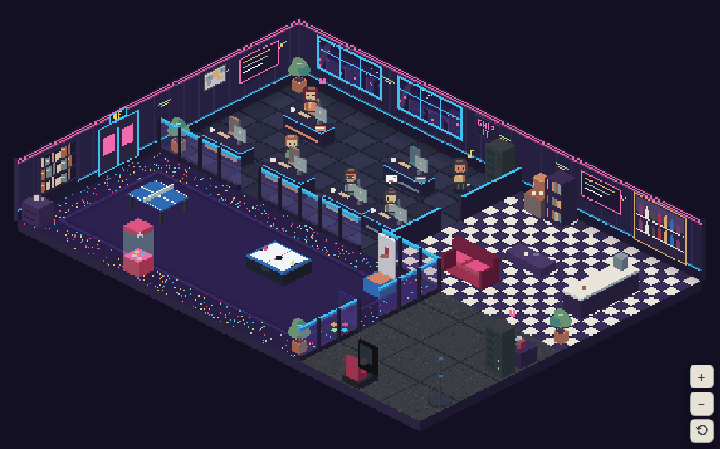
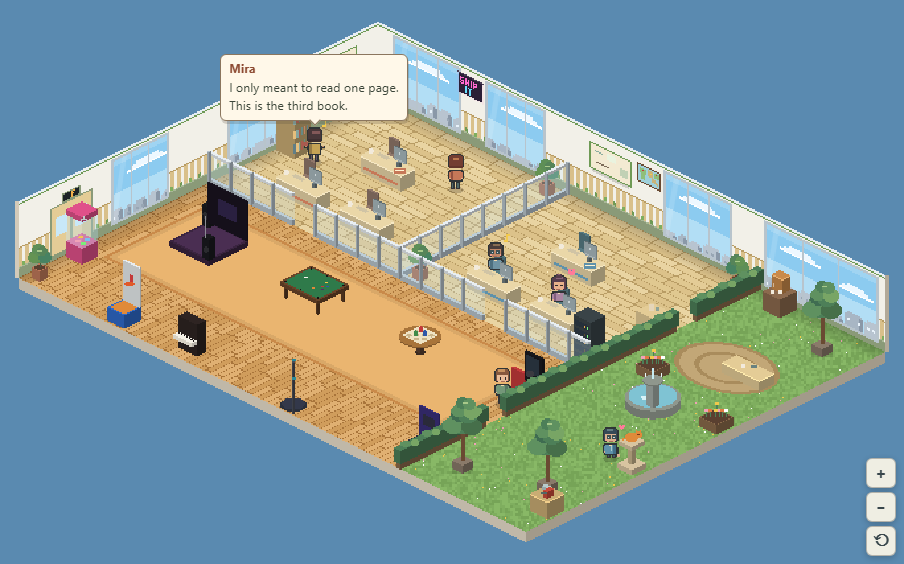
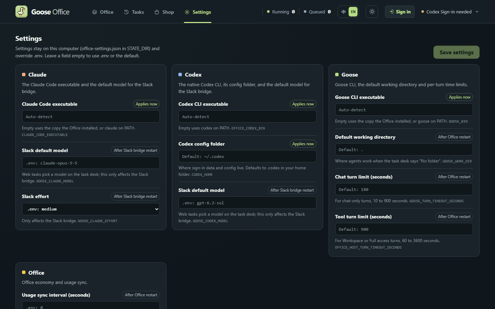

<div align="center">

# Goose Office

**由 Claude 與 Codex 帶領 AI 團隊的像素辦公室。**
把任務交給兩位主管，看員工在工作之餘走動、聊天、玩遊戲，再用掉的額度換一間更大的辦公室。

[English](README.md) · 繁體中文

 



</div>

Goose Office 是一個本機網頁應用，透過 [Goose](https://github.com/aaif-goose/goose) 使用你現有的 **Claude Code** 與 **OpenAI Codex** 訂閱。Claude 和 Codex 兩位主管各帶兩名員工。你在交辦台指派工作，他們會親自回覆、分派員工、互相審閱成果，平時就住在一間會越用越大的等角視角像素辦公室裡。

另外附有選用的 **Slack 橋接器**，讓同樣兩位代理以各自的 Bot 身分進駐私人 Slack 頻道。

> [!NOTE]
> 一切都在你的電腦上執行。網頁只監聽 `127.0.0.1`，資料存在 `.data/`，登入使用你自己的 Claude 與 ChatGPT 訂閱。每次實際交辦都會使用訂閱額度。

## 目錄

- [功能](#功能)
- [快速開始](#快速開始)
- [使用辦公室](#使用辦公室)
- [辦公室經營](#辦公室經營)
- [設定](#設定)
- [Slack 橋接器](#slack-橋接器)
- [開發](#開發)
- [授權](#授權)

## 功能

| | |
| --- | --- |
| **兩位主管、四位員工** | Claude 帶研究員 Mira 和審閱員 Theo，Codex 帶工程師 Finn 和測試員 Nova。主管可親自回覆、分派員工，或規劃最多六個工序的分工。 |
| **能真的動手，權限由你決定** | 每則交辦可選專案資料夾與權限：「僅對話」、「工作區」（在資料夾內讀寫與執行指令）或「完整存取權」。 |
| **附件、引用、記憶** | 附加圖片、PDF 與文字檔，直接貼上截圖，引用舊任務，並為每位成員核准記憶與技能。 |
| **會動的辦公室** | 七層等角視角樓層。員工會在座位做小動作、四處走動、找同事聊天，還會邀同事一起打桌球、空氣曲棍球、撞球或唱卡拉OK。 |
| **辦公室經營** | 用掉的額度會變成資金，可以買零食禮物、家具、遊樂設施和福利，搬上更大的樓層。 |
| **中文 / English** | 在頂部導覽列一鍵切換整個介面的繁體中文與英文。 |
| **設定分頁** | 不用改 `.env`，就能指定 Claude Code、Codex 與 Goose 的執行檔，並調整時間上限。 |
| **訂閱用量** | 查看各訂閱額度視窗已用多少、何時重置。 |

## 快速開始

**需要：** Node.js 24 以上、可用於 Claude Code 的 Claude 訂閱，以及可用於 Codex 的 ChatGPT 訂閱。Goose CLI 與 Claude Code 可在第一次使用時自動安裝。

```powershell
git clone https://github.com/danieltsai0423/goose-slack-agents.git
cd goose-slack-agents
npm ci
npm run office
```

開啟 **http://127.0.0.1:4178/**，點右上角「**登入 → 開始設定**」。Goose Office 會把缺少的工具安裝到專案的狀態目錄，再依序開啟 Claude 和 ChatGPT 的官方授權頁面。已登入的帳號會跳過，檢查登入狀態也不會送出模型請求。

<details>
<summary><b>手動設定</b>（系統不支援自動安裝時）</summary>

- **Goose CLI：** 專案以 [Goose 1.60.2](https://github.com/aaif-goose/goose/releases/tag/v1.60.2) 為基準。Windows 可把官方 ZIP 解壓到 `.tools/goose`、把 `goose.exe` 加入 `PATH`，或在「設定」分頁指定路徑。
- **Goose 的 Codex：** 執行 `npm run configure -- codex`，選 **Configure Providers → ChatGPT Codex**，在瀏覽器用自己的 ChatGPT 帳號登入。原生 Codex CLI 的登入不會帶進這個 Goose profile。
- **Claude：** 用自己的訂閱登入 Claude Code（`claude auth login`）。第三方工具能否使用 Claude 帳號、如何計費，由 Anthropic 決定，見 [Claude 帳號登入說明](https://support.claude.com/en/articles/13189465-log-in-to-your-claude-account)。
- **原生 Codex CLI（選用）：** 可解鎖 Goose 尚未支援的 `xhigh` 與 `max` 推理強度。

  ```powershell
  npm install --prefix .tools/office-codex --save-exact @openai/codex@0.171.0
  node .tools/office-codex/node_modules/@openai/codex/bin/codex.js login
  ```

各送一次實際模型請求來檢查登入：

```powershell
npm run smoke -- codex
npm run smoke -- claude
```

</details>

## 使用辦公室


1. **選擇收件主管**：在交辦台選 Claude、Codex 或雙主管，再選模型與推理強度，瀏覽器會記住你的選擇。預設是 Opus 5.5 · Medium 與 GPT-6.2 Sol · XHigh（未登入原生 Codex CLI 時改用 High）。
2. **選擇資料夾與權限**：在左下角設定。「僅對話」不使用工具，「工作區」只在專案資料夾內動作，「完整存取權」可存取網路與電腦上的任何檔案。
3. **送出**：主管會決定親自回覆或分派。執行中的工作紀錄會顯示每一回合、工具使用與耗時，之後可在同一串繼續追問。

交辦台的其他工具：

- **附件**：支援 PNG、JPEG、WebP、PDF、TXT、Markdown、CSV 和 JSON。一次最多 5 個檔案，單張圖片 7 MB、其他檔案 10 MB，合計 20 MB，也可直接貼上截圖。
- **引用**：搜尋舊任務，附上最多四則片段當作參考資料。
- **分工**：最多六個工序，各有負責人與前置工序，最後由一位主管審閱。不同模型服務、互不依賴的純對話工序可並行。失敗的工序可在「**分工看板**」重試。
- **記憶與技能**：在「任務紀錄 → 記憶與技能」為每位成員提出、核准、退回或封存。技能只在交辦符合觸發詞時載入。
- **成果**：有工具權限的代理可以把檔案存到 `.data/office-files/`，並在對話裡附上下載連結。圖片、影片與音訊可直接預覽。

回覆支援 Markdown 粗體、清單、表格、連結與程式碼。任務與對話存在 `.data/office.sqlite`。

> [!IMPORTANT]
> Claude 與 Goose 路徑沒有沙箱，「工作區」只靠指示限制範圍；原生 Codex CLI 則使用 `workspace-write` 與 `danger-full-access` 沙箱。請只對信任的任務使用「完整存取權」。

## 辦公室經營



沒有任務時，每個人都有自己的生活。在座位上會喝茶、滑手機、托腮思考、伸懶腰，累了會打瞌睡，或是轉轉椅子。他們也會走去白板、窗邊或休息區，到同事座位旁聊天，有人經過時揮揮手。一接到任務就會走回座位。

**資金：** 每用掉 1% 訂閱額度賺 $40，再乘上樓層、家具、福利與團隊士氣倍率。工作會讓負責的那一組變累；心情和精力越好，士氣倍率越高（×0.8 到 ×1.25）。


**商店**分成四類：

- **道具**：焙茶、濃縮咖啡、珍奶、拉麵、甜點、午睡枕等，可以送給個人（每人有一樣最愛，效果 ×1.6），也有派對、溫泉旅行等全員活動。
- **家具**：盆景、咖啡機、魚缸、辦公室貓咪、睡眠艙等，以及**十種遊樂設施**。單人遊戲有夾娃娃機、投籃機、跳舞機、VR 和賽車模擬器；2×2 的大型設施有桌球、空氣曲棍球、撞球、卡拉OK 和桌遊，員工會互相邀約一起玩。設施只有在有人玩時才會動。
- **福利**：彈性工時、健身補助、寵物友善、年終分紅，買一次永久有效。
- **樓層**：大樓共七層，越高越貴、收入越高，也放得下越多家具：

| 樓層 | 大小 | 地面 / 大型 / 牆面格位 |
| --- | --- | --- |
| 1F 暖木工作室 | 14 × 11 | 3 / 0 / 1 |
| 2F 工業風 Loft | 16 × 12 | 5 / 1 / 2 |
| 3F 中世紀摩登 | 18 × 13 | 6 / 1 / 2 |
| 4F 霓虹遊戲基地 | 20 × 14 | 6 / 2 / 2 |
| 5F 森林中庭 | 20 × 14 | 6 / 2 / 2 |
| 6F 天際頂樓 | 20 × 15 | 7 / 2 / 2 |
| 7F 空中園區 | 24 × 17 | 8 / 3 / 3 |

起始的工作室放不下 2×2 的大型設施。放不下的家具會先收進倉庫，搬上更大的樓層時自動擺出來。資金與心情存在 `.data/office-economy.json`。

**操作：** 拖曳移動，滾輪或雙指縮放，方向鍵與 `+`、`−`、`0` 也可以。辦公區標題列的「**辦公室日常**」是動畫總開關：系統要求減少動態效果時預設關閉，手動打開後就會照常播放。

## 設定



頂部導覽列的「**設定**」可以設定這三個工具，不用修改 `.env`。設定存在你電腦上的 `.data/office-settings.json`，優先於 `.env`；欄位留空就沿用 `.env` 或內建預設值。每個欄位都會標示是立即生效還是重啟後生效。

| 設定 | 變數 | 生效時機 |
| --- | --- | --- |
| Claude Code 執行檔 | `CLAUDE_CODE_EXECUTABLE` | 立即 |
| Codex CLI 執行檔 | `OFFICE_CODEX_BIN` | 立即 |
| Codex 設定資料夾 | `CODEX_HOME` | 立即 |
| Goose CLI 執行檔 | `GOOSE_BIN` | 立即 |
| 預設工作目錄 | `GOOSE_WORK_DIR` | 重啟 Office 後 |
| 對話回合時間上限（10–900 秒） | `GOOSE_TURN_TIMEOUT_SECONDS` | 重啟 Office 後 |
| 工具回合時間上限（60–3600 秒） | `OFFICE_HOST_TURN_TIMEOUT_SECONDS` | 重啟 Office 後 |
| 用量同步間隔（0 或 60–86400 秒） | `OFFICE_ECONOMY_SYNC_SECONDS` | 重啟 Office 後 |
| Slack 預設模型與推理強度 | `GOOSE_CLAUDE_MODEL`、`GOOSE_CODEX_MODEL`、`GOOSE_CLAUDE_EFFORT` | 重啟 Slack 橋接器後 |

這些也都能寫在 `.env`（見 [`.env.example`](.env.example)），另外 `OFFICE_PORT` 可改網頁連接埠，`STATE_DIR` 可搬移資料目錄。

## Slack 橋接器

橋接器讓 `Goose-Codex` 和 `Goose-Claude` 在私人 Slack 頻道以各自的 Bot 身分回覆。單一程序接收頻道訊息，用 SQLite 記錄討論串，只有在點名或開啟協作時才呼叫模型。網頁辦公室的「任務紀錄 → Slack 紀錄」可唯讀查看橋接器存下的討論串。

| Agent | Goose provider | 帳號 |
| --- | --- | --- |
| Goose-Codex | `chatgpt_codex` | 橋接器專用 Goose 設定中的 ChatGPT 登入 |
| Goose-Claude | `claude-acp` | 同一系統帳戶中，Claude Code 登入的個人 Claude 訂閱 |

<details>
<summary><b>建立 Slack App</b></summary>

1. 在 workspace 建立私人頻道，例如 `#agent-lab`，再用下列其中一種方式建立兩個 App：
   - **用 API：** 在 [Slack App 管理頁](https://api.slack.com/apps) 為 workspace 產生 *App Configuration Token*，在本機 `.env.slack-setup` 填 `SLACK_MANIFEST_TOKEN=...`，然後執行 `npm run slack:setup`。指令會驗證兩個 manifest、建立 App 並顯示安裝頁面。App ID 存在 `.data/slack-setup`，重跑會沿用。完成後請清除短效 token。（[Slack Manifest API](https://docs.slack.dev/app-manifests/configuring-apps-with-app-manifests/)）
   - **用 Slack 管理頁：** 選 **Create New App → From a manifest**，分別匯入 [Codex manifest](slack/codex.json) 與 [Claude manifest](slack/claude.json)。
2. 安裝兩個 App，把各自的 **Bot User OAuth Token**（`xoxb-…`）填進 `.env`。
3. 在 **Goose-Codex** App 建立有 `connections:write` 的 App-Level Token（`xapp-…`），填入 `SLACK_CODEX_APP_TOKEN`。這個 App 透過 Socket Mode 接收頻道訊息。
4. 把兩個 App 加入頻道，在 `.env` 填入頻道 ID 和你自己的 Slack member ID。`.env` 請只留在本機。
5. 執行 `npm start`，顯示已連線後，在頻道送出 `@all 各自介紹你能怎麼協助我`。

</details>

| 訊息 | 行為 |
| --- | --- |
| 普通訊息 | 記錄為脈絡。若該串開啟了自主回覆，兩位代理會判斷是否有值得補充的內容，這個判斷會使用模型額度。 |
| Slack 原生點名 `@Goose-Claude` 或 `@Goose-Codex` | 呼叫被點名的代理，兩個一起點名就平行回答。 |
| `@all 各自比較這兩個方案` | 兩位代理讀取同一份快照，平行回覆。`@all` 直接打成文字；開頭用 `@頻道`／`@這裡` 效果相同。 |
| `@all 一起完成這個方案` | 開啟該串的自主回覆。Claude 先回答，Codex 接力，每次觸發最多四輪。開頭也可用「協作」或「接力」。 |
| `@Goose-Claude 執行：跑測試並回報結果` | 被點名的代理會使用主機工具執行，結果回到同一串。 |
| `@all 執行：檢查這個專案並跑測試` | Claude 先執行，Codex 接著檢查結果並補做。 |
| `!auto on` / `!auto off` | 開啟或關閉該串的自主回覆。 |
| `!stop` | 關閉自主回覆，停止執行中的模型程序並清空佇列。 |

只有設定的擁有者能在指定頻道下指令。「執行：」任務會以橋接器系統帳號的權限使用檔案與 Shell，不會逐項請求核准。

## 開發

```powershell
npm test
```

測試使用模擬代理與隔離的資料庫，不需要 Slack、模型或網路。架構、資料流與修改入口請看 [代理交接手冊（AGENTS.md）](AGENTS.md)。

| 範圍 | 位置 |
| --- | --- |
| 網頁、交辦台、任務紀錄 | `office/index.html`、`office/app.js`、`office/style.css` |
| 辦公室場景、樓層、人物 | `office/scene.js`、`office/iso-*.js`、`office/behavior.js`、`office/life.js` |
| 商店與經營 | `office/economy.js`、`office/office-shop.js`、`src/office-economy.mjs` |
| 翻譯 | `office/i18n.js`、`office/i18n-en.js`（以中文原文為鍵的英文對照） |
| 服務、任務、模型 | `src/office-server.mjs`、`src/office-runtime.mjs`、`src/office-runner.mjs`、`src/goose.mjs` |
| Slack 橋接器 | `src/main.mjs`、`src/bridge.mjs`、`src/store.mjs` |

**請勿提交** `.env`、`.data/` 或 `.tools/`：這些資料夾存著你的登入資料、對話與下載的工具，`.gitignore` 已排除它們。

## 授權

[MIT](LICENSE)。Claude、Claude Code、Codex、ChatGPT、Goose 與 Slack 是各自所有者的商標；本專案與這些公司沒有關聯，也未獲其背書。
